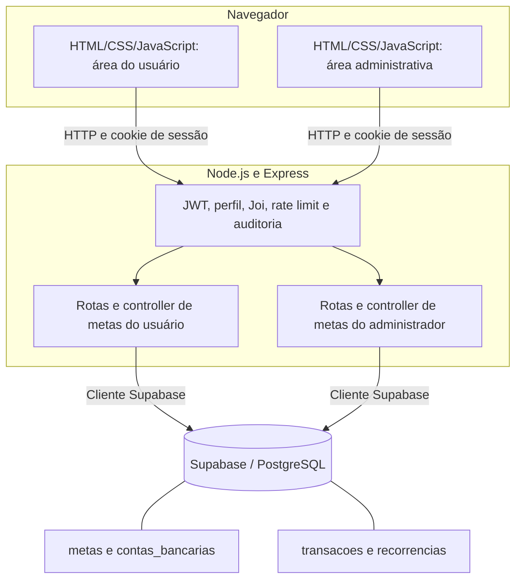

# RF-007: Gerir Metas Financeiras

## 1. Identificação

- **ID:** RF-007.
- **Título:** Gerir Metas Financeiras.
- **Prioridade:** Alta.
- **Complexidade:** 13 story points — estimativa relativa considerando CRUD, filtros, permissões administrativas e integração com transações.

### a) URL da Aplicação (Deploy Online)

- **URL:** https://cashland-cdf0.onrender.com/
- **Plataforma:** Render.
- **Acesso do professor — usuário comum:** email `prof.edilberto.silva@gmail.com`; senha `12345678910`.
- **Acesso do professor — administrador:** email `prof1.edilberto.silva@gmail.com`; senha `12345678910`.

### b) Link do Banco de Dados Online

- **BD:** Supabase — PostgreSQL.
- **Link:** https://supabase.com/dashboard/project/xjfgkakjpuxoznbwznyb
- **Tabela principal da RF-007:** `metas`.

### c) Link do GitHub

- **Repositório:** https://github.com/JoaoSousa2002/CashLand
- **Branch principal:** `main`.

---

## 2. Descrição e Atores

A RF-007 permite organizar metas financeiras vinculadas às contas bancárias do usuário. No cadastro, são informados a conta, o nome e o valor objetivo, além da descrição e da data limite quando desejado. A consulta apresenta o valor atual, o valor objetivo, o prazo e o status armazenados para cada meta.

O usuário pode consultar suas metas, pesquisar por nome ou identificador e combinar filtros por contas e status. Na edição, pode alterar conta, nome, descrição, valor objetivo e data limite. O identificador, o status, o valor atual e as datas de criação e atualização são apresentados somente para consulta. A exclusão é disponibilizada no menu contextual da listagem e exige confirmação.

O administrador possui acesso às listagens e aos formulários administrativos para consultar, editar e excluir metas. Pode consultar diferentes usuários ou informar um proprietário nos filtros. As alterações e exclusões administrativas exigem identificar o proprietário da meta. O pertencimento é determinado pela conta bancária associada, pois a tabela de metas não possui coluna própria de usuário.

A integração com a RF-006 permite associar transações e recorrências a uma meta por meio do identificador opcional `id_meta`. O backend verifica o proprietário da meta e rejeita a associação com transações do tipo Transferencia. Os registros financeiros associados podem ser consultados pelos filtros da RF-006.

### Benefícios para o negócio

- Organizar os objetivos financeiros pessoais por conta bancária.
- Consultar valores, prazos e status das metas em uma listagem centralizada.
- Localizar objetivos por nome, identificador, contas e status.
- Relacionar objetivos com transações e recorrências já registradas no sistema.
- Permitir administração dos registros com verificação de perfil e proprietário.

### Atores

- **Usuário autenticado:** cria, consulta, edita e exclui as próprias metas — Create, Read, Update e Delete. Acessa as telas da área do usuário e utiliza as funcionalidades da RF-006 para associar movimentações a metas.
- **Administrador autenticado:** consulta metas de diferentes usuários e edita ou exclui registros do proprietário informado — Read, Update e Delete na área administrativa. Não existe uma rota administrativa específica de criação de metas.

### Validações necessárias

- A conta bancária, o nome e o valor objetivo são obrigatórios no cadastro.
- A conta informada deve existir e pertencer ao proprietário da operação.
- O nome deve conter pelo menos um caractere após a remoção dos espaços das extremidades.
- O nome não pode repetir o de outra meta do mesmo usuário, inclusive em outra conta.
- O valor objetivo deve ser numérico, positivo, finito e possuir no máximo duas casas decimais.
- A descrição é opcional e aceita texto vazio ou nulo.
- A data limite é opcional; quando preenchida, deve ser uma data válida no formato AAAA-MM-DD.
- Os identificadores de meta, conta e usuário devem ser inteiros entre 1 e 2.147.483.647 nos schemas de metas.
- O filtro de status aceita Em progresso ou Finalizado.
- Edição e exclusão administrativas exigem o identificador do proprietário; na listagem administrativa, esse filtro é opcional.
- Campos não previstos no schema da operação são rejeitados.

---

## 3. Casos de Uso

### Fluxo principal: criar meta financeira

**Pré-condições:** usuário autenticado e conta bancária existente em seu nome.

- O usuário acessa Gerir metas na área do usuário.
- Seleciona Criar meta.
- O sistema verifica a sessão e carrega as contas bancárias.
- O usuário seleciona uma conta.
- Informa o nome da meta.
- Opcionalmente, informa a descrição.
- Informa o valor objetivo.
- Preenche a data limite ou deixa a meta sem prazo.
- Seleciona Criar meta para enviar o formulário.
- O sistema valida os campos e verifica o pertencimento da conta.
- O sistema verifica se o nome já existe entre as metas desse usuário.
- O backend insere a meta no banco e confirma o registro criado.
- A aplicação apresenta a mensagem de sucesso.
- Ao continuar, o usuário retorna à listagem.

**Pós-condições:** meta persistida em `metas`, associada à conta selecionada e disponível para consulta.

### Fluxo principal: consultar e filtrar metas

**Pré-condição:** usuário autenticado.

- O usuário acessa Gerir metas.
- O sistema carrega as contas e consulta as metas do usuário.
- A tabela apresenta ID, nome, conta, valor atual, valor objetivo, data limite e status.
- O usuário pode informar parte do nome ou o ID no campo de pesquisa.
- Seleciona Pesquisar para atualizar a consulta.
- Opcionalmente, seleciona Filtrar.
- Escolhe uma ou mais contas e o status desejado.
- Seleciona Aplicar filtros.
- O sistema combina os critérios e restringe o resultado ao proprietário autenticado.
- A listagem apresenta os registros correspondentes ou a mensagem Nenhuma meta encontrada.

**Pós-condição:** metas exibidas conforme pesquisa, filtros e permissões do usuário.

### Fluxo principal: editar meta

**Pré-condições:** usuário autenticado e meta existente em seu nome.

- O usuário abre o menu contextual da linha com o botão direito.
- Seleciona Ver.
- A página de edição recebe o ID da meta pela URL.
- O sistema consulta a meta e seleciona o registro com o identificador exato.
- Exibe ID, status, valor atual e datas de controle em campos bloqueados.
- O usuário altera conta, nome, descrição, valor objetivo ou data limite.
- Seleciona Salvar alterações.
- O frontend envia o ID e os campos alterados.
- O backend verifica os dados, o pertencimento da meta e a conta informada.
- Quando o nome é alterado, verifica duplicidade desconsiderando a própria meta.
- O sistema confirma a atualização e apresenta o resultado.

**Pós-condição:** campos enviados atualizados na meta, preservando os demais dados.

### Fluxo principal: excluir meta

**Pré-condições:** usuário autenticado, meta própria e ausência de impedimento pelas referências do banco.

- O usuário localiza a meta na listagem.
- Abre o menu contextual da linha.
- Seleciona Excluir.
- O sistema apresenta a confirmação com o nome e o ID da meta.
- O sistema informa que a ação não poderá ser desfeita.
- O usuário seleciona Continuar.
- A API recebe o identificador pelo caminho da solicitação.
- O backend verifica a existência e o pertencimento da meta.
- Solicita a exclusão e confirma o registro removido.
- A interface apresenta o resultado e atualiza a listagem.

**Pós-condição:** meta removida do banco e da listagem.

### Fluxo principal: administrar metas

**Pré-condição:** usuário autenticado com perfil Admin.

- O administrador acessa Gerir metas na área administrativa.
- O sistema apresenta metas com o identificador do proprietário relacionado à conta.
- O administrador pesquisa por nome ou ID e pode abrir os filtros.
- Pode informar um usuário, selecionar contas e escolher o status.
- Aplica os filtros para atualizar a consulta.
- Abre o menu contextual da meta desejada.
- Seleciona Ver para editar ou Excluir para iniciar a confirmação.
- Na edição, o sistema recebe pela URL os IDs da meta e do proprietário.
- O administrador altera os campos permitidos e salva, ou confirma a exclusão.
- O backend verifica o perfil administrativo e o pertencimento do registro ao proprietário informado.
- A aplicação executa a operação autorizada e apresenta o resultado.

**Pós-condição:** consulta, edição ou exclusão realizada no contexto do proprietário correto.

### Fluxo alternativo: nome de meta já existe

- Durante a criação ou edição, o sistema encontra outra meta do mesmo usuário com o nome informado.
- A API retorna HTTP 409 com a mensagem Já existe uma meta com esse nome.
- A operação não é concluída.
- O usuário pode corrigir o nome e enviar novamente.

### Fluxo alternativo: dados inválidos

- A solicitação contém campos obrigatórios ausentes, tipos inválidos, valores não permitidos ou campos desconhecidos.
- A API retorna HTTP 400 com a lista de erros.
- O frontend apresenta os erros associados aos campos correspondentes.
- O usuário corrige os dados e repete o envio.

### Fluxo alternativo: registro inexistente ou de outro proprietário

- O backend verifica o identificador e seu relacionamento com a conta do usuário.
- Se a meta ou a conta não existir ou não pertencer ao proprietário esperado, retorna HTTP 404.
- A alteração ou exclusão é interrompida.

### Fluxo alternativo: consulta sem resultados

- Nenhuma meta corresponde à pesquisa e aos filtros.
- A API retorna HTTP 404 com a mensagem Nenhuma meta encontrada.
- A tela apresenta a mensagem na tabela e permite alterar os critérios.

### Fluxo alternativo: exclusão cancelada ou impedida

- Se o usuário selecionar Cancelar, a confirmação é fechada e a meta é preservada.
- Se confirmar a exclusão de uma meta referenciada por transações ou recorrências, a chave estrangeira pode impedir a remoção.
- Na falha de exclusão retornada pelo banco, a API responde HTTP 500 e a interface informa que a operação não foi concluída.

### Fluxo alternativo: sessão ou permissão inválida

- Sessão ausente, inválida ou expirada provoca HTTP 401 na API.
- Usuário comum tentando executar uma operação administrativa recebe HTTP 403.
- A operação protegida não é executada.

### Requisitos não funcionais

- **RNF-01 — Autenticação e autorização:** as rotas de metas devem exigir sessão válida, restringir operações comuns aos registros próprios e exigir perfil Admin nas operações administrativas.
- **RNF-02 — Usabilidade:** a interface deve apresentar os estados vazio, preenchido, erro, carregando e sucesso, com mensagens em português e confirmação de exclusão.
- **RNF-03 — Responsividade:** as páginas devem permitir uso em 320px, 768px e 1024px ou mais, com acesso ao conteúdo e à tabela.
- **RNF-04 — Integridade e persistência:** as operações devem utilizar o banco online e respeitar as relações entre metas, contas e registros financeiros.
- **RNF-05 — Controle de solicitações:** as rotas devem aplicar os limitadores de frequência definidos para criação, consulta, edição e exclusão, retornando HTTP 429 ao exceder a janela.

### Regras de negócio

- **RN-01:** toda meta criada pela API deve estar vinculada a uma conta pertencente ao usuário autenticado.
- **RN-02:** o proprietário da meta é identificado pela conta bancária vinculada.
- **RN-03:** nomes duplicados entre metas do mesmo usuário são rejeitados na criação e edição.
- **RN-04:** o valor objetivo deve ser positivo e informado com no máximo duas casas decimais.
- **RN-05:** descrição e data limite são opcionais; enviar nulo permite remover esses valores na edição.
- **RN-06:** o status admite somente Em progresso ou Finalizado.
- **RN-07:** ID, status, valor atual e datas de criação e atualização não são alteráveis pelo formulário nem pelo contrato de edição de metas.
- **RN-08:** pesquisa por nome ou ID, contas e status podem ser utilizados em conjunto.
- **RN-09:** a listagem administrativa permite consulta global; informar o usuário restringe o resultado ao proprietário selecionado.
- **RN-10:** edição e exclusão administrativas exigem identificar o proprietário da meta.
- **RN-11:** uma transação ou recorrência só pode ser vinculada a uma meta do mesmo proprietário.
- **RN-12:** transações do tipo Transferencia não podem ser vinculadas a metas.
- **RN-13:** a conta da movimentação pode ser diferente da conta da meta, desde que ambas pertençam ao mesmo usuário.

---

## 4. Protótipo

Interface com CRUD em: https://cashland-cdf0.onrender.com/

- **Criar meta:** `/tela-principal/criar-meta`.
- **Listar metas:** `/tela-principal/listar-metas`.
- **Consultar e editar meta:** `/tela-principal/editar-meta?id_meta=ID_DA_META`.
- **Listagem administrativa:** `/tela-admin/listar-metas`.
- **Edição administrativa:** `/tela-admin/editar-meta?id_meta=ID_DA_META&id_usuario=ID_DO_USUARIO`.
- **Exclusão:** disponível pelo menu contextual da linha, com confirmação.

| Operação              | Método | Endpoint                                     | Status esperado         |
| --------------------- | ------ | -------------------------------------------- | ----------------------- |
| Create                | POST   | `/usuario/criar-meta`                        | 201                     |
| Read                  | GET    | `/usuario/listar-metas`                      | 200; 404 sem resultados |
| Update                | PATCH  | `/usuario/editar-meta`                       | 200                     |
| Delete                | DELETE | `/usuario/deletar-meta/{id_meta}`            | 200                     |
| Read administrativo   | GET    | `/admin/listar-metas`                        | 200; 404 sem resultados |
| Update administrativo | PATCH  | `/admin/editar-meta`                         | 200                     |
| Delete administrativo | DELETE | `/admin/deletar-meta/{id_meta}/{id_usuario}` | 200                     |

A consulta de detalhes utiliza a listagem com o parâmetro `pesquisa` e seleciona o ID exato na tela de edição. O cadastro aceita `id_conta`, `nome`, `descricao`, `valor_meta` e `data_meta`. A edição recebe `id_meta` e os campos alterados; na administração recebe também `id_usuario`.

**Documentação da API:** `docs/api/API-SWAGGER.json` — OpenAPI 3.0.

**Swagger UI:** https://cashland-cdf0.onrender.com/api-docs/

**DDL da RF-007:** `database/ddl/RF-007-Gerir_metas.sql`.

---

## 5. Arquitetura

### Diagrama de arquitetura

### Componentes e padrão de design

- **Frontend:** HTML, CSS e JavaScript nativo, com páginas específicas para criação, listagem e edição.
- **Backend:** Node.js com Express, módulos ES, roteadores, controllers e middlewares compartilhados.
- **Banco de dados:** PostgreSQL no Supabase, acessado pelo backend por meio do cliente Supabase.
- **Padrão:** arquitetura em camadas, separando apresentação, roteamento/validação, processamento das operações e persistência. Essa separação permite reutilizar autenticação e validação sem concentrar toda a aplicação nas páginas HTML.

### Decisões arquiteturais

- **ADR-001 — Frontend com HTML/CSS/JavaScript:** manter o padrão das demais RFs e reutilizar template, menus, formulários e tratamento de resultados sem introduzir um framework adicional.
- **ADR-002 — Backend Node.js com Express:** centralizar o CRUD e as verificações de acesso, usando a estrutura existente de rotas, controllers e middlewares.
- **ADR-003 — PostgreSQL no Supabase:** reutilizar o banco online do projeto e relacionar metas com contas, transações e recorrências por chaves estrangeiras.
- **ADR-004 — Validação Joi por operação:** aplicar contratos diferentes a cadastro, edição parcial, consulta e exclusão, com mensagens associadas aos campos.
- **ADR-005 — Separação de rotas comuns e administrativas:** distinguir operações sobre dados próprios das operações que exigem perfil Admin e proprietário informado.

### Fluxo de dados

- O usuário preenche ou consulta os dados na interface.
- O frontend envia a solicitação HTTP com o cookie de sessão.
- O Express executa os middlewares de auditoria, frequência, autenticação, autorização aplicável e validação.
- O controller verifica o pertencimento e as regras da operação.
- O cliente Supabase executa a consulta ou alteração no PostgreSQL.
- O backend retorna o status HTTP e a resposta da operação.
- A interface atualiza o formulário ou a listagem e apresenta o resultado.

---

## 6. Segurança

### Controle 1 — Autenticação de sessão

- **Vulnerabilidade OWASP:** falhas de autenticação que permitam operações financeiras sem sessão válida.
- **Implementação:** JWT em cookie HttpOnly, verificado nas rotas privadas; cookie configurado com SameSite Strict e Secure em produção. A API recusa token ausente, inválido ou expirado.
- **Teste:** os cenários locais de autenticação da RF-007 verificaram HTTP 401 nas rotas sem sessão, sem consulta ao banco simulado. Os cenários administrativos verificaram também HTTP 403 para usuário comum.

### Controle 2 — Controle de acesso e prevenção de IDOR

- **Vulnerabilidade OWASP:** acesso indevido por troca de identificadores de meta, conta ou proprietário.
- **Implementação:** listagem comum limitada ao usuário autenticado; verificação do proprietário pela conta da meta; verificação de conta na criação/edição; exigência de perfil Admin e proprietário compatível nas alterações administrativas.
- **Teste:** cenários locais de edição e exclusão com meta inexistente ou alheia retornaram HTTP 404 e preservaram os dados simulados. Cenários administrativos também recusaram proprietário ou conta incompatíveis.

### Controle 3 — Validação de entrada e proteção contra alteração de campos indevidos

- **Vulnerabilidade OWASP:** entrada malformada e alteração não autorizada de propriedades enviadas pelo cliente.
- **Implementação:** schemas Joi validam campos, tipos, identificadores, datas e valores; campos desconhecidos são rejeitados. Status, valor atual e datas de controle não fazem parte dos campos aceitos na edição de metas.
- **Teste:** os cenários locais de validação da RF-007 recusaram campos obrigatórios ausentes, IDs inválidos, valor objetivo inválido, datas inexistentes e campos não autorizados com HTTP 400. Os testes de nome verificaram HTTP 409 para duplicidade e permitiram manter o nome da própria meta.
