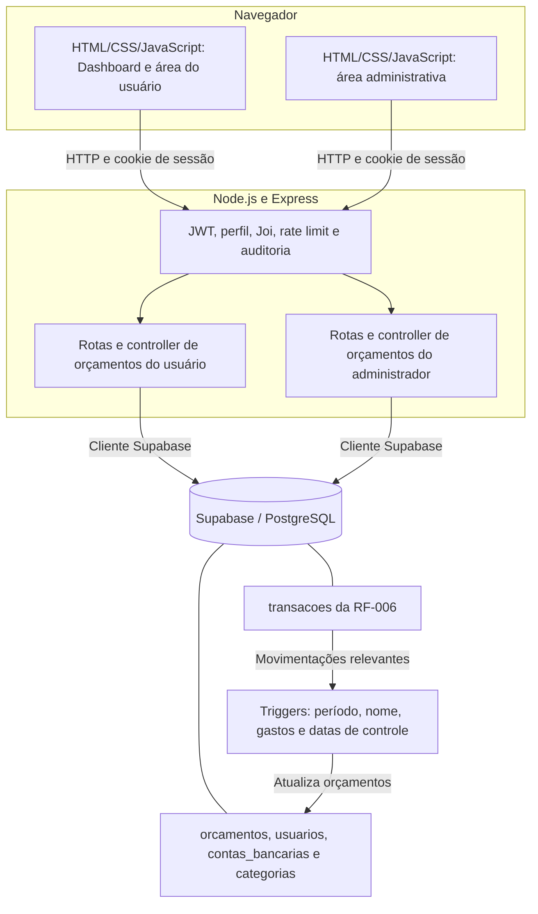

# RF-008: Gerir Orçamentos

## 1. Identificação

- **ID:** RF-008.
- **Título:** Gerir Orçamentos.
- **Prioridade:** Alta.
- **Complexidade:** 13 story points — estimativa relativa considerando CRUD, filtros de período, permissões administrativas, integração com transações e apresentação no Dashboard.

### a) URL da Aplicação (Deploy Online)

- **URL:** https://cashland-cdf0.onrender.com/
- **Plataforma:** Render.

### b) Link do Banco de Dados Online

- **BD:** Supabase — PostgreSQL.
- **Link:** https://supabase.com/dashboard/project/xjfgkakjpuxoznbwznyb
- **Tabela principal da RF-008:** `orcamentos`.

### c) Link do GitHub

- **Repositório:** https://github.com/JoaoSousa2002/CashLand
- **Branch principal:** `main`.

---

## 2. Descrição e Atores

A RF-008 permite definir limites de gastos por conta bancária, categoria ou combinação de ambas, em períodos semanais, mensais ou anuais. No cadastro, o usuário informa os vínculos, o valor do orçamento e o tipo de período, podendo informar uma descrição e escolher o período atual ou o próximo. O sistema identifica o proprietário pela sessão, e o banco gera o nome, o fim do período, o valor atual e as datas de controle.

O usuário pode consultar seus orçamentos, pesquisar por nome e combinar filtros por identificador, conta, categoria, tipo de período e intervalo de datas. Na edição, pode alterar os vínculos, a descrição, o limite, o tipo de período e o início. Identificador, proprietário, nome, valor atual, fim do período e datas de criação e atualização são dados de consulta. A exclusão é disponibilizada no menu de opções da linha e exige confirmação.

O administrador possui acesso às listagens e aos formulários administrativos para consultar, editar e excluir orçamentos. Pode consultar diferentes usuários ou informar um proprietário nos filtros. As alterações e exclusões administrativas exigem identificar o proprietário do orçamento. O pertencimento é determinado pela coluna `id_usuario` da própria tabela `orcamentos`.

A integração com a RF-006 utiliza as transações do tipo Saida com status Pago e data de pagamento dentro do período do orçamento. O banco soma os valores compatíveis com o proprietário e os vínculos definidos, preenchendo `valor_atual`. Quando conta e categoria estão preenchidas, a transação precisa atender aos dois critérios. Entradas, transferências e transações pendentes não compõem esse total. O limite `valor_orcamento` permanece sendo o valor informado no cadastro ou na edição.

O Dashboard da tela principal apresenta somente os orçamentos atuais, cujo período inclui a data de hoje em `America/Sao_Paulo`. A tabela permite abrir a edição de cada registro e sinaliza por cor a distância em relação ao limite. A consulta ocorre após a confirmação da sessão e funciona independentemente do carregamento do saldo da conta.

### Benefícios para o negócio

- Planejar limites de gastos por conta, categoria e período.
- Acompanhar despesas pagas em comparação com os valores orçados.
- Localizar registros por nome, identificadores e sobreposição de períodos.
- Identificar no Dashboard orçamentos próximos do limite ou excedidos.
- Permitir administração dos registros com verificação de perfil e proprietário.

### Atores

- **Usuário autenticado:** cria, consulta, edita e exclui os próprios orçamentos — Create, Read, Update e Delete. Acompanha os orçamentos atuais no Dashboard e registra as movimentações financeiras pela RF-006.
- **Administrador autenticado:** consulta orçamentos de diferentes usuários e edita ou exclui registros do proprietário informado — Read, Update e Delete na área administrativa. Não existe uma rota administrativa específica de criação de orçamentos.

### Validações necessárias

- É obrigatório informar uma conta bancária, uma categoria ou ambas no cadastro, mantendo pelo menos um vínculo na edição.
- Cada conta ou categoria informada deve existir e pertencer ao proprietário da operação.
- O valor do orçamento é obrigatório no cadastro, numérico, positivo, finito, com no máximo duas casas decimais e limitado a R$ 9.999.999.999,99.
- O tipo de período é obrigatório no cadastro e aceita somente Semanal, Mensal ou Anual.
- A descrição é opcional e aceita texto vazio ou nulo.
- Quando informado, o início deve ser uma data válida no formato AAAA-MM-DD e corresponder ao início do período atual ou do próximo, considerando `America/Sao_Paulo`. No cadastro, a omissão utiliza o período atual.
- O período semanal começa no domingo e termina no sábado; o mensal começa no primeiro dia e termina no último dia do mês; o anual vai de primeiro de janeiro a 31 de dezembro.
- Alterar o tipo de período exige informar o início correspondente. Na edição, campos de período omitidos preservam o período armazenado, inclusive quando antigo.
- Os identificadores de orçamento, conta, categoria e usuário devem ser inteiros entre 1 e 2.147.483.647 nos schemas de orçamentos.
- Na consulta, as datas dos filtros devem ser válidas; quando ambas forem informadas, o fim não pode ser anterior ao início. A consulta aceita períodos históricos.
- Nome, valor atual, fim do período e datas de controle não podem ser enviados como campos de criação ou edição. Na área comum, o proprietário vem da sessão.
- Edição e exclusão administrativas exigem o identificador do proprietário; na listagem administrativa, esse filtro é opcional.
- A edição deve conter ao menos um campo alterável além dos identificadores. Campos desconhecidos são rejeitados, e a exclusão não aceita campos no corpo da solicitação.

---

## 3. Casos de Uso

### Fluxo principal: criar orçamento

**Pré-condições:** usuário autenticado e existência de uma conta bancária ou categoria em seu nome.

- O usuário acessa Gerir orçamentos na área do usuário.
- Seleciona Criar orçamento.
- O sistema verifica a sessão e carrega as contas bancárias e as categorias.
- O usuário seleciona uma conta, uma categoria ou ambas.
- Opcionalmente, informa a descrição.
- Informa o valor do orçamento.
- Escolhe o tipo de período e seleciona o período atual ou o próximo.
- Seleciona Criar orçamento para enviar o formulário.
- O sistema valida os campos, o período e o pertencimento dos vínculos.
- O backend obtém o proprietário pela sessão e solicita a inserção.
- Os triggers do banco definem o fim do período, geram o nome, calculam o valor atual e preenchem as datas de controle.
- O backend confirma o registro criado e apresenta a mensagem de sucesso.
- Ao continuar, o usuário retorna à listagem.

**Pós-condições:** orçamento persistido em `orcamentos`, associado ao proprietário e aos vínculos selecionados, disponível para consulta.

### Fluxo principal: consultar e filtrar orçamentos

**Pré-condição:** usuário autenticado.

- O usuário acessa Gerir orçamentos.
- O sistema consulta os orçamentos do usuário.
- A tabela apresenta ID, nome, conta, categoria, valor gasto, limite, tipo de período, início e fim.
- O usuário pode informar parte do nome e selecionar Pesquisar.
- Opcionalmente, seleciona Filtrar.
- Informa ID do orçamento, conta, categoria, tipo de período ou datas.
- Seleciona Aplicar filtros.
- O sistema combina os critérios com AND e restringe o resultado ao proprietário autenticado.
- O filtro `periodo_inicio` mantém orçamentos que terminam nessa data ou depois dela.
- O filtro `periodo_fim` mantém orçamentos que começam nessa data ou antes dela.
- A listagem apresenta os registros correspondentes ou a mensagem Nenhum orçamento encontrado.
- O usuário pode limpar os filtros para consultar novamente todos os seus registros.

**Pós-condição:** orçamentos exibidos conforme pesquisa, filtros e permissões do usuário, incluindo períodos históricos quando correspondentes.

### Fluxo principal: acompanhar orçamentos atuais no Dashboard

**Pré-condição:** usuário autenticado na tela principal.

- O sistema confirma a sessão e apresenta o Dashboard.
- Inicia a consulta dos orçamentos independentemente da consulta de saldo.
- Obtém a data de hoje em `America/Sao_Paulo`, no formato AAAA-MM-DD.
- Envia essa data nos dois filtros, `periodo_inicio` e `periodo_fim`, da listagem comum.
- O backend seleciona os orçamentos do usuário com `periodo_inicio <= hoje <= periodo_fim`.
- A tabela Orçamentos atuais apresenta, nesta ordem: botão `ver`, nome, valor atual, valor do orçamento, início e fim do período.
- Os valores são formatados em reais e as datas em DD/MM/AAAA, preservando o dia retornado pela API.
- O sistema compara o gasto e o limite em centavos e aplica a cor correspondente ao fundo de todas as células da linha.
- O usuário seleciona `ver` para abrir diretamente a edição do orçamento daquela linha.
- Para consultar outros períodos ou gerenciar registros, utiliza Gerir orçamentos no menu.

**Pós-condição:** orçamentos vigentes apresentados, incluindo os que começam ou terminam hoje e excluindo os que terminaram antes ou começam depois.

### Fluxo principal: editar orçamento

**Pré-condições:** usuário autenticado e orçamento existente em seu nome.

- O usuário abre as opções da linha na listagem e seleciona Ver, ou utiliza o botão `ver` no Dashboard.
- A página de edição recebe `id_orcamento` pela URL.
- O sistema consulta a listagem com esse identificador e seleciona o registro exato.
- Exibe identificador, proprietário, nome, valor atual, fim do período e datas de controle em campos bloqueados.
- O usuário altera conta, categoria, descrição, valor do orçamento ou período.
- Se remover um vínculo, mantém o outro preenchido.
- Se alterar o tipo de período, informa o início correspondente.
- Seleciona Salvar alterações.
- O frontend envia o identificador e os campos alterados.
- O backend verifica os dados, o pertencimento do orçamento e dos vínculos, além do estado final da edição.
- O banco atualiza os campos automáticos e preserva o limite informado e os campos omitidos conforme suas regras.
- O sistema confirma a atualização e apresenta o resultado.

**Pós-condição:** orçamento atualizado, preservando seu identificador, proprietário e data de criação.

### Fluxo principal: excluir orçamento

**Pré-condições:** usuário autenticado e orçamento próprio existente.

- O usuário localiza o orçamento na listagem e abre as opções da linha.
- Seleciona Excluir.
- O sistema apresenta a confirmação com o nome e o ID do orçamento e informa que a ação não poderá ser desfeita.
- O usuário seleciona Continuar.
- A API recebe o identificador pelo caminho da solicitação.
- O backend restringe a exclusão pelo ID do orçamento e pelo proprietário autenticado.
- Confirma o registro removido e apresenta o resultado.
- Ao continuar, a interface atualiza a listagem.

**Pós-condição:** orçamento removido, preservando as contas, categorias e transações relacionadas.

### Fluxo principal: administrar orçamentos

**Pré-condição:** usuário autenticado com perfil Admin.

- O administrador acessa Gerir orçamentos na área administrativa.
- O sistema apresenta os orçamentos com o identificador do proprietário.
- O administrador pesquisa por nome e pode filtrar por usuário, orçamento, conta, categoria, tipo de período e datas.
- Sem filtro de usuário, a consulta abrange diferentes proprietários.
- Abre as opções da linha e seleciona Ver ou Excluir.
- Na edição, a página recebe os IDs do orçamento e do proprietário pela URL e carrega os vínculos desse proprietário.
- O administrador altera os campos permitidos e salva, ou confirma a exclusão.
- O backend verifica o perfil Admin, a existência do proprietário e o pertencimento do orçamento e dos vínculos informados.
- A aplicação executa a operação autorizada e apresenta o resultado.

**Pós-condição:** consulta, edição ou exclusão realizada no contexto do proprietário correto.

### Fluxo alternativo: orçamento com nome gerado já existe

- O banco gera o nome a partir dos vínculos e do período.
- Se o nome resultante já existir, a restrição de unicidade impede a criação ou edição.
- A API retorna HTTP 409 com a mensagem Já existe um orçamento com esse nome.
- O usuário pode rever os vínculos e o período antes de enviar novamente; o nome não é digitado manualmente.

### Fluxo alternativo: dados inválidos

- A solicitação contém campos obrigatórios ausentes, tipos inválidos, valores não permitidos, datas inexistentes ou campos desconhecidos.
- A API retorna HTTP 400; os erros de validação por campo são apresentados junto aos campos correspondentes.
- Também são recusadas a remoção do último vínculo, a troca de tipo de período sem início e a escolha de início fora do período atual ou do próximo.
- O usuário corrige os dados e repete o envio.

### Fluxo alternativo: registro inexistente ou de outro proprietário

- O backend verifica o orçamento e os vínculos no contexto do proprietário esperado.
- Se o orçamento, a conta ou a categoria não existir ou não pertencer a esse proprietário, retorna HTTP 404.
- Na administração, informar um usuário inexistente também resulta em HTTP 404.
- A alteração ou exclusão não é concluída.

### Fluxo alternativo: consulta sem resultados

- Nenhum orçamento corresponde à pesquisa e aos filtros.
- A API retorna HTTP 200 com uma lista vazia.
- A listagem apresenta Nenhum orçamento encontrado e permite alterar os critérios.
- No Dashboard, a tabela apresenta Nenhum orçamento atual, mantendo os demais controles utilizáveis.

### Fluxo alternativo: exclusão cancelada ou falha na operação

- Se o usuário selecionar Cancelar, a confirmação é fechada e o orçamento é preservado.
- Se o banco falhar ao consultar, gravar ou excluir, a API apresenta o erro correspondente; falhas não tratadas como validação, inexistência ou conflito retornam HTTP 500.
- A interface não confirma sucesso quando a operação falha.
- No Dashboard, uma falha de consulta apresenta uma mensagem na tabela orientando recarregar a página; o menu e o seletor de saldo continuam disponíveis.

### Fluxo alternativo: sessão ou permissão inválida

- Sessão ausente, inválida ou expirada provoca HTTP 401 na API.
- Usuário comum tentando executar uma operação administrativa recebe HTTP 403.
- A operação protegida não é executada.

### Requisitos não funcionais

- **RNF-01 — Autenticação e autorização:** as rotas de orçamentos devem exigir sessão válida, restringir operações comuns aos registros próprios e exigir perfil Admin nas operações administrativas.
- **RNF-02 — Usabilidade:** a interface deve apresentar os estados vazio, preenchido, erro, carregando e sucesso, com mensagens em português e confirmação de exclusão. A consulta do Dashboard deve funcionar independentemente do saldo.
- **RNF-03 — Responsividade:** as páginas devem permitir uso em 320px, 768px e 1024px ou mais, com acesso aos controles e rolagem da tabela quando necessário.
- **RNF-04 — Integridade e persistência:** as operações devem utilizar o banco online e respeitar as relações entre orçamentos, usuários, contas, categorias e transações, mantendo o cálculo dos gastos no banco.
- **RNF-05 — Controle de solicitações:** as rotas devem aplicar os limitadores de frequência definidos para criação, consulta, edição e exclusão, retornando HTTP 429 ao exceder a janela.

### Regras de negócio

- **RN-01:** todo orçamento possui um proprietário em `id_usuario`; na criação e nas operações comuns, o proprietário é obtido da sessão.
- **RN-02:** o orçamento deve manter uma conta bancária, uma categoria ou ambas, pertencentes ao proprietário.
- **RN-03:** o limite deve ser positivo, ter no máximo duas casas decimais e respeitar a capacidade de `numeric(12, 2)`.
- **RN-04:** os períodos admitidos são Semanal, Mensal e Anual, com início e fim definidos pelo calendário. O fim deve ser posterior ao início e não pode anteceder a data de criação no fuso de São Paulo.
- **RN-05:** a criação utiliza o período atual quando o início é omitido. O início enviado na criação ou edição deve corresponder ao período atual ou ao próximo; alterações que omitem o período preservam o já armazenado.
- **RN-06:** o banco gera o nome com os nomes e IDs dos vínculos e a indicação do período. A unicidade é aplicada ao nome completo na tabela. Renomear uma conta ou categoria aciona a sincronização dos nomes dos orçamentos vinculados.
- **RN-07:** `valor_atual` soma somente transações Saida/Pago do proprietário, com data de pagamento dentro do período inclusivo e compatíveis com todos os vínculos preenchidos.
- **RN-08:** criação e edição do orçamento recalculam o gasto. O trigger da RF-006 também recalcula os orçamentos afetados por inserção, alteração relevante ou exclusão de transações. Sem despesas compatíveis, o valor atual é zero.
- **RN-09:** o cálculo do gasto não modifica `valor_orcamento`. Ultrapassar o limite é permitido e sinalizado no Dashboard; o orçamento não bloqueia o registro de despesas.
- **RN-10:** identificador, proprietário, nome, valor atual, fim do período e datas de controle não são livremente alteráveis pelo formulário nem pelo contrato de edição. O proprietário informado pelo administrador identifica o alvo, sem transferir a propriedade.
- **RN-11:** campos omitidos no PATCH são preservados. Enviar nulo remove um vínculo, desde que outro permaneça; a descrição aceita texto vazio ou nulo.
- **RN-12:** filtros de identificador, nome, conta, categoria, tipo de período e datas podem ser combinados com AND. As datas aplicam sobreposição inclusiva, e não exigem igualdade entre os períodos.
- **RN-13:** a listagem administrativa permite consulta global; informar `id_usuario` restringe o resultado ao proprietário selecionado. Edição e exclusão administrativas exigem esse identificador.
- **RN-14:** excluir um orçamento não exclui seus vínculos nem as transações. A exclusão de usuário, conta ou categoria referenciada remove os orçamentos dependentes por `ON DELETE CASCADE`.
- **RN-15:** o Dashboard considera atual o orçamento com `periodo_inicio <= hoje <= periodo_fim`, usando a data de `America/Sao_Paulo` nos dois filtros da API.
- **RN-16:** as cores do Dashboard são determinadas em centavos, nesta ordem: vermelho quando o gasto excede o limite; amarelo quando resta de R$ 0,00 a R$ 99,99; verde quando restam R$ 100,00 ou mais. O fundo deve abranger todas as células, inclusive a do botão `ver`.
- **RN-17:** com limite de R$ 500,00, gastos de R$ 399,99 e R$ 400,00 produzem verde; R$ 400,01 e R$ 500,00 produzem amarelo; R$ 500,01 produz vermelho.
- **RN-18:** o Dashboard apresenta somente botão `ver`, nome, valor atual, valor do orçamento, início e fim, nessa ordem. O botão abre a edição com o `id_orcamento` correto; a listagem existente permanece responsável por filtros e gerenciamento.

---

## 4. Protótipo

Interface com CRUD em: https://cashland-cdf0.onrender.com/

- **Dashboard com orçamentos atuais:** `/tela-principal`.
- **Criar orçamento:** `/tela-principal/criar-orcamento`.
- **Listar orçamentos:** `/tela-principal/listar-orcamentos`.
- **Consultar e editar orçamento:** `/tela-principal/editar-orcamento?id_orcamento=ID_DO_ORCAMENTO`.
- **Listagem administrativa:** `/tela-admin/listar-orcamentos`.
- **Edição administrativa:** `/tela-admin/editar-orcamento?id_orcamento=ID_DO_ORCAMENTO&id_usuario=ID_DO_USUARIO`.
- **Exclusão:** disponível pelo menu de opções da linha na listagem, com confirmação.

| Operação              | Método | Endpoint                                                | Status esperado               |
| --------------------- | ------ | ------------------------------------------------------- | ----------------------------- |
| Create                | POST   | `/usuario/criar-orcamento`                               | 201                           |
| Read                  | GET    | `/usuario/listar-orcamentos`                             | 200; lista vazia sem resultados |
| Update                | PATCH  | `/usuario/editar-orcamento`                              | 200                           |
| Delete                | DELETE | `/usuario/deletar-orcamento/{id_orcamento}`               | 200                           |
| Read administrativo   | GET    | `/admin/listar-orcamentos`                               | 200; lista vazia sem resultados |
| Update administrativo | PATCH  | `/admin/editar-orcamento`                                | 200                           |
| Delete administrativo | DELETE | `/admin/deletar-orcamento/{id_usuario}/{id_orcamento}`    | 200                           |

A consulta de detalhes utiliza a listagem com `id_orcamento` e seleciona o ID exato na tela de edição; na área administrativa, informa também `id_usuario`. O cadastro aceita `id_conta`, `id_categoria`, `descricao`, `valor_orcamento`, `tipo_periodo` e `periodo_inicio`. A edição recebe `id_orcamento` e os campos alterados; na administração recebe também `id_usuario`.

O Dashboard utiliza `GET /usuario/listar-orcamentos?periodo_inicio=AAAA-MM-DD&periodo_fim=AAAA-MM-DD`, preenchendo ambos os parâmetros com a data de hoje em São Paulo. O proprietário é identificado pelo cookie de sessão, sem envio de `id_usuario` pela tela. Os dados de gasto e limite vêm da resposta da API.

**Documentação da API:** `docs/api/swagger.json` — OpenAPI 3.0.

**Swagger UI:** https://cashland-cdf0.onrender.com/api-docs/

**DDL da RF-008:** `database/ddl/RF-008-Gerir-orcamentos.sql`.

**Integração com transações:** `database/ddl/RF-006-Gerir-transacoes-financeiras.sql` — função `atualizar_orcamentos_por_transacao` e trigger `rf008_transacoes_orcamentos`.

**Sincronização dos nomes dos vínculos:** `database/ddl/RF-004-Gerir-categorias.sql` e `database/ddl/RF-005-Gerir-contas-financeiras.sql` — função `sincronizar_nomes_orcamentos` e triggers de alteração dos nomes de categorias e contas.

Os endereços online são os registrados no projeto. Os comportamentos descritos correspondem ao código do workspace; a publicação do Dashboard e a instalação dos triggers no banco online não foram verificadas nesta documentação.

---

## 5. Arquitetura

### Diagrama de arquitetura

### Componentes e padrão de design

- **Frontend:** HTML, CSS e JavaScript nativo, com páginas específicas para criação, listagem e edição e uma tabela de orçamentos atuais na tela principal.
- **Backend:** Node.js com Express, módulos ES, roteadores, controllers e middlewares compartilhados. `src/validacoes/usuario.js` contém os schemas Joi e `src/validacoes/orcamentos.js` valida a escolha do período.
- **Banco de dados:** PostgreSQL no Supabase, acessado pelo backend por meio do cliente Supabase. Funções e triggers mantêm nome, períodos, gastos e datas de controle.
- **Padrão:** arquitetura em camadas, separando apresentação, roteamento/validação, processamento das operações e persistência. O Dashboard reutiliza a listagem existente, sem criar uma nova rota de API ou recalcular os gastos no navegador.

### Decisões arquiteturais

- **ADR-001 — Frontend com HTML/CSS/JavaScript:** manter o padrão das demais RFs e reutilizar template, menus, formulários e tratamento de resultados sem introduzir um framework adicional.
- **ADR-002 — Backend Node.js com Express:** centralizar o CRUD e as verificações de acesso, usando a estrutura existente de rotas, controllers e middlewares.
- **ADR-003 — PostgreSQL no Supabase:** reutilizar o banco online do projeto e manter vínculos, integridade e cálculo dos gastos por funções e triggers, preservando o limite informado pelo usuário.
- **ADR-004 — Validação Joi por operação:** aplicar contratos diferentes a cadastro, edição parcial, consulta e exclusão, com mensagens associadas aos campos e verificação adicional das regras de período no backend.
- **ADR-005 — Separação de rotas comuns e administrativas:** distinguir operações sobre dados próprios das operações que exigem perfil Admin e proprietário informado.
- **ADR-006 — Reutilização da listagem no Dashboard:** consultar os orçamentos atuais pelos filtros de sobreposição inclusiva, com a data de São Paulo, e utilizar a edição existente para abrir cada registro.

### Fluxo de dados

- O usuário preenche ou consulta os dados na interface.
- O frontend envia a solicitação HTTP com o cookie de sessão.
- O Express executa os middlewares de auditoria, frequência, autenticação, autorização aplicável e validação.
- O controller identifica o proprietário, aplica filtros ou verifica os vínculos e as regras da operação.
- O cliente Supabase executa a consulta ou alteração no PostgreSQL.
- Na criação e edição, os triggers de orçamentos mantêm os campos automáticos. Alterações relevantes nas transações acionam o recálculo dos orçamentos afetados.
- O backend retorna o status HTTP e a resposta da operação.
- A interface atualiza o formulário, a listagem ou o Dashboard e apresenta o resultado. Textos retornados pela API são inseridos na tabela com `textContent`.

---

## 6. Segurança

### Controle 1 — Autenticação de sessão

- **Vulnerabilidade OWASP:** falhas de autenticação que permitam operações financeiras sem sessão válida.
- **Implementação:** JWT em cookie HttpOnly, verificado nas rotas privadas; cookie configurado com SameSite Strict e Secure em produção. A API recusa token ausente, inválido ou expirado e exige perfil Admin nas rotas administrativas.
- **Teste:** os cenários locais de `tests/testar_rotas.py --testes-rf08` verificam HTTP 401 nas sete rotas sem sessão, sem consulta ao banco simulado, e HTTP 403 para usuário comum nas operações administrativas. `tests/browser/dashboard.test.js` verifica que a tela principal só consulta orçamentos e saldo após a confirmação da sessão e preserva o logout.

### Controle 2 — Controle de acesso e prevenção de IDOR

- **Vulnerabilidade OWASP:** acesso indevido por troca de identificadores de orçamento, conta, categoria ou proprietário.
- **Implementação:** a listagem comum aplica `id_usuario` da sessão. Edição e exclusão combinam ID do orçamento e proprietário; conta e categoria são verificadas no mesmo contexto. Operações administrativas exigem perfil Admin e proprietário compatível. Os triggers também verificam o pertencimento dos vínculos ao gerar o nome.
- **Teste:** os cenários locais da RF-008 recusam alterações e exclusões de registros inexistentes ou alheios com HTTP 404 e preservam os dados simulados. Os cenários administrativos verificam proprietário e vínculos incompatíveis. O teste de navegador do Dashboard utiliza a rota e o controller reais com banco simulado e verifica resultados separados para dois usuários autenticados.

### Controle 3 — Validação de entrada e proteção contra alteração de campos indevidos

- **Vulnerabilidade OWASP:** entrada malformada e alteração não autorizada de propriedades enviadas pelo cliente.
- **Implementação:** schemas Joi validam campos, tipos, identificadores, datas e valores; campos desconhecidos são rejeitados. Nome, valor atual, fim do período e datas de controle não integram os campos aceitos na edição. O backend valida o período e a permanência de ao menos um vínculo; o banco aplica as restrições de integridade e gera os campos automáticos.
- **Teste:** `tests/orcamentos.test.js` e os cenários Python da RF-008 cobrem limites, datas, períodos, campos indevidos, PATCH parcial, erros de integridade e conflitos de unicidade. `tests/browser/orcamentos.test.js` verifica formulários, filtros e campos bloqueados. O teste do Dashboard verifica que um nome contendo marcação HTML é apresentado como texto, além dos cinco limites de cores e dos estados de carregamento, vazio e erro.

As suítes locais citadas passaram na execução de `npm run test:local` realizada nesta sessão, com banco simulado. Essa execução não valida SQL ou triggers em um banco real. A suíte separada `npm run test:rf08:banco` utiliza `tests/testar_orcamentos_banco.py` e não foi executada nesta sessão.
